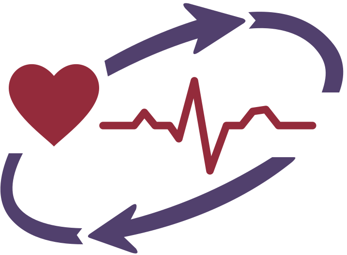
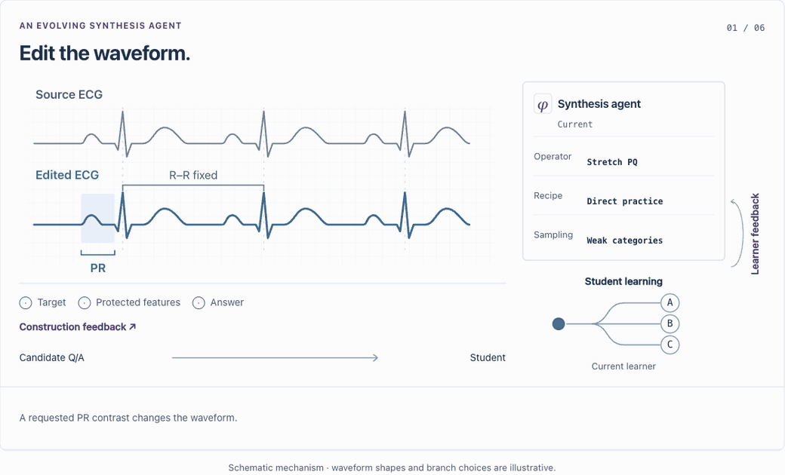

<div align="center">

<p> &nbsp;&nbsp;  &nbsp;&nbsp;  &nbsp;&nbsp; </p>

<h1> ECG-RSI</h1>

**Recursive Self-Improvement<br>through Targeted Electrocardiogram Waveform Evolution**

[](papers/ecg-rsi.pdf)
[](https://pork-pay.github.io/ECG-RSI/)

<p>Xiaoliang Wang<sup>1,2*</sup>, Zhuo Chen<sup>2*</sup>, Chuanyang Zheng<sup>2</sup>, Jiangwei Lao<sup>2</sup>, Quanbin Wang<sup>2</sup>, Honglin Lin<sup>3,4</sup>,<br>
Jiajia Liu<sup>2</sup>, Zhihong Lu<sup>2</sup>, Hao Jin<sup>1</sup>, Jian Wang<sup>2</sup>, Lijun Wu<sup>2,3†</sup></p>

<p><sup>1</sup> Zhejiang University &nbsp;·&nbsp; <sup>2</sup> Ant Group<br>
<sup>3</sup> Shanghai Artificial Intelligence Laboratory &nbsp;·&nbsp; <sup>4</sup> Shanghai Jiao Tong University</p>

<sup>*</sup> Equal contribution &nbsp;·&nbsp; <sup>†</sup> Corresponding author

</div>

<p align="center">
  <a href="https://pork-pay.github.io/ECG-RSI/#evolution"></a>
</p>

<p align="center">
  <strong>The best teaching strategy changes as the learner improves.</strong><br>
  Check learning gains on independent benchmarks.<br>
  <a href="https://pork-pay.github.io/ECG-RSI/#evolution">Explore the interactive walkthrough →</a>
</p>

## Results

Qwen3.5-35B-A3B, after three rounds.

| Mean metric | Base | ECG-RSI |
|:--|--:|--:|
| QA accuracy (%) | 34.57 | **56.04** |
| Classification F1 | 24.27 | **34.03** |

[Full results and comparisons →](https://pork-pay.github.io/ECG-RSI/#findings)

## Release plan

| Item | Status |
|:--|:--|
| Paper (PDF) | ✅ [Available](papers/ecg-rsi.pdf) |
| Project page & interactive demo | ✅ [Available](https://pork-pay.github.io/ECG-RSI/) |
| arXiv posting | 🔜 In progress |
| Discovered programs | ⏳ Being prepared |
| Full codebase | ⏳ Being prepared |
| Reproduction scripts | ⏳ Being prepared |

Related project: [MedEvo](https://pork-pay.github.io/MedEvo/)

<details>
<summary>Citation</summary>

```bibtex
@misc{wang2026ecgrsi,
  title = {ECG-RSI: Recursive Self-Improvement through Targeted Electrocardiogram Waveform Evolution},
  author = {Wang, Xiaoliang and Chen, Zhuo and Zheng, Chuanyang and Lao, Jiangwei and Wang, Quanbin and Lin, Honglin and Liu, Jiajia and Lu, Zhihong and Jin, Hao and Wang, Jian and Wu, Lijun},
  year = {2026},
  url = {https://pork-pay.github.io/ECG-RSI/}
}
```

</details>
