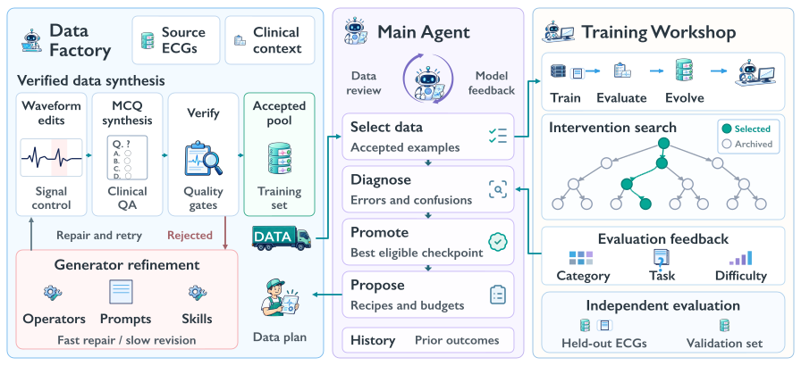

<div align="center">

<p>
   &nbsp;&nbsp;
   &nbsp;&nbsp;
   &nbsp;&nbsp;
  
</p>

# ECG-RSI: Recursive Self-Improvement<br>through Targeted ECG Waveform Evolution

[**Paper**](papers/ecg-rsi.pdf) · [**Website**](https://pork-pay.github.io/ECG-RSI/) · [**LaTeX Source**](papers/ECG_RSI_arXiv.zip)

Wang Xiaoliang, Zhuo Chen, Chuanyang Zheng, Jiangwei Lao, Quanbin Wang, Honglin Lin, Jiajia Liu, Zhihong Lu, Hao Jin, Jian Wang, Lijun Wu

Zhejiang University · Ant Group · Shanghai Artificial Intelligence Laboratory · Shanghai Jiao Tong University

</div>

## Overview

**ECG-RSI combines verified ECG waveform synthesis with feedback-guided recursive self-improvement.** It edits waveforms to express targeted feature contrasts, remeasures the resulting signals, and constructs evidence-grounded questions. Construction feedback repairs the generator; learner feedback proposes training interventions that are compared on a separate selection set.



## Highlights

- **Measurement-grounded synthesis.** Verify target changes and protected features before accepting supervision.
- **Adaptive supervision.** The retained three-round trajectory shifts from direct reinforcement to confusion-focused contrasts.
- **External evaluation.** Across seven benchmarks, mean QA accuracy rises from **34.57% to 56.04%**, mean classification F1 from **24.27 to 34.03**, and the seven-benchmark aggregate from **30.15 to 46.61** (F1 and aggregate on a 0–100 scale).

**[Explore the method and results →](https://pork-pay.github.io/ECG-RSI/)**

The paper and LaTeX source are available above. Training and synthesis implementation code is not included in this release.

## Citation

```bibtex
@misc{wang2026ecgrsi,
  title = {ECG-RSI: Recursive Self-Improvement through Targeted ECG Waveform Evolution},
  author = {Wang, Xiaoliang and Chen, Zhuo and Zheng, Chuanyang and Lao, Jiangwei and Wang, Quanbin and Lin, Honglin and Liu, Jiajia and Lu, Zhihong and Jin, Hao and Wang, Jian and Wu, Lijun},
  year = {2026},
  url = {https://github.com/pork-pay/ECG-RSI}
}
```
