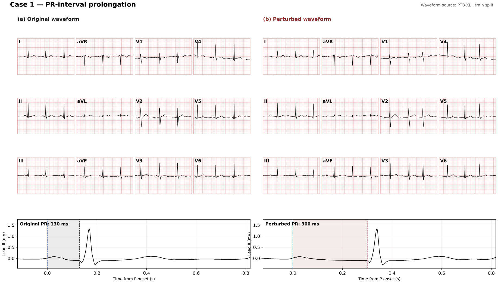

<div align="center">

<p>
   &nbsp;&nbsp;&nbsp;
   &nbsp;&nbsp;&nbsp;
   &nbsp;&nbsp;&nbsp;
  
</p>

# ECG-RSI

### Recursive Self-Improvement through Targeted ECG Waveform Evolution

[**Paper**](papers/ecg-rsi.pdf) · [**Project page**](https://pork-pay.github.io/ECG-RSI/) · [**GitHub**](https://github.com/pork-pay/ECG-RSI) · [**LaTeX source**](papers/ECG_RSI_arXiv.zip)

<p>
  <a href="https://openreview.net/profile?id=~Wang_Xiaoliang2">Xiaoliang Wang</a><sup>1,2,*</sup>,
  <a href="https://openreview.net/profile?id=~Zhuo_Chen3">Zhuo Chen</a><sup>2,*</sup>,
  <a href="https://openreview.net/profile?id=~Chuanyang_Zheng2">Chuanyang Zheng</a><sup>2</sup>,
  <a href="https://openreview.net/profile?id=~Jiangwei_Lao1">Jiangwei Lao</a><sup>2</sup>,
  <a href="https://openreview.net/profile?id=~Quanbin_Wang1">Quanbin Wang</a><sup>2</sup>,
  <a href="https://openreview.net/profile?id=~Honglin_Lin2">Honglin Lin</a><sup>3,4</sup>,
  <a href="https://openreview.net/profile?id=~Jiajia_Liu1">Jiajia Liu</a><sup>2</sup>,
  <a href="https://openreview.net/profile?id=~Zhihong_Lu2">Zhihong Lu</a><sup>2</sup>,
  <a href="https://openreview.net/profile?id=~Hao_Jin4">Hao Jin</a><sup>1</sup>,
  <a href="https://openreview.net/profile?id=~Jian_Wang25">Jian Wang</a><sup>2</sup>,
  <a href="https://openreview.net/profile?id=~Lijun_Wu1">Lijun Wu</a><sup>3,4,†</sup>
</p>

<p><sup>1</sup> Zhejiang University · <sup>2</sup> Ant Group<br>
<sup>3</sup> Shanghai Artificial Intelligence Laboratory · <sup>4</sup> Shanghai Jiao Tong University</p>

<p><sup>*</sup> Equal contribution. &nbsp; <sup>†</sup> Corresponding author.</p>

</div>

## Which ECG example should the model learn from next?

**ECG-RSI turns learner errors into candidate training interventions, verifies their waveform evidence, and compares their value to the learner.** It connects two decisions: whether a generated example supports its answer, and whether training on that kind of example improves the current model.

- **Construction feedback:** remeasure edited ECGs, check target and protected features, and verify the question–answer pair. Failures guide repairs to the construction process.
- **Learner feedback:** diagnose category, task, difficulty and confusion errors; propose training recipes; compare matched branches from the same parent on a separate selection set.
- **External evaluation:** measure the retained learner on benchmarks outside generation and selection.

## From a target to measurable evidence

A PR-prolongation request specifies a **300 ms** target. The pipeline lengthens the PQ segment, compensates in the TP segment to preserve the RR interval, and measures the result: **PR 298 ms; heart rate 74.6 bpm**. It constructs the question from those achieved measurements.



*Recorded example from the paper appendix. Values follow the automatic measurement convention used in the data-construction pipeline.*

The forward route derives supervision from an existing training ECG. The reverse route first constructs a requested feature contrast. Both routes check waveform evidence and question validity before accepting examples. [Explore the full framework and waveform operators on the project page.](https://pork-pay.github.io/ECG-RSI/#method)

## What the experiments show

1. **The preferred intervention changes.** The retained three-round trajectory starts with direct reinforcement of AV-block coverage and measurement questions, then selects regional STEMI contrasts and rhythm contrasts. Candidate comparison determines which proposed intervention to retain.
2. **The content of added data matters.** From a shared checkpoint with S7 = 43.22, four configurations each add 10,000 questions. Their gains are +0.93 for ordinary training questions, +1.05 for forward synthesis, +2.34 for forward + reverse synthesis with fixed selection proportions, and +3.01 with feedback-guided selection.
3. **Local improvement has diminishing external returns.** Feedback errors continue to fall while successive S7 gains shrink to +13.07, +3.01 and +0.38. Some individual benchmark scores decline in the final round.

Reported main trajectory (**R-A**, Qwen3.5-35B-A3B):

| Metric | Starting model | After three rounds | Change |
| --- | ---: | ---: | ---: |
| Mean QA accuracy, four benchmarks | 34.57% | 56.04% | +21.47 percentage points |
| Mean classification F1, three benchmarks | 24.27 | 34.03 | +9.77 points |
| S7, equal-weight seven-benchmark mean | 30.15 | 46.61 | +16.46 points |

F1 and S7 use a 0–100 scale. Means and gains follow the paper; gains are calculated before rounding. These results describe the reported model, training protocol and benchmark suite. [Inspect the per-benchmark trajectory and experiment context.](https://pork-pay.github.io/ECG-RSI/#findings)

## Repository contents

| Location | Contents |
| --- | --- |
| [`papers/ecg-rsi.pdf`](papers/ecg-rsi.pdf) | Paper with experimental protocols and appendix |
| [`papers/ECG_RSI_arXiv.zip`](papers/ECG_RSI_arXiv.zip) | LaTeX source package |
| [`index.html`](index.html), [`assets/`](assets/) | Static project page, figures, styles and citation interaction |

The current release contains the paper and project-page materials. **The synthesis and training implementation, model weights and training-data files are not included.**

To preview the project page locally, run `python3 -m http.server 8000` from this directory and open `http://localhost:8000`. No build step or external frontend dependencies are required.

## Related project

[**MedEvo**](https://pork-pay.github.io/MedEvo/) preserves and repairs medical reasoning trajectories; ECG-RSI constructs and verifies waveform evidence. Both study how targeted supervision becomes useful to a learner.

## Citation

```bibtex
@misc{wang2026ecgrsi,
  title = {ECG-RSI: Recursive Self-Improvement through Targeted ECG Waveform Evolution},
  author = {Wang, Xiaoliang and Chen, Zhuo and Zheng, Chuanyang and Lao, Jiangwei and Wang, Quanbin and Lin, Honglin and Liu, Jiajia and Lu, Zhihong and Jin, Hao and Wang, Jian and Wu, Lijun},
  year = {2026},
  url = {https://pork-pay.github.io/ECG-RSI/}
}
```
